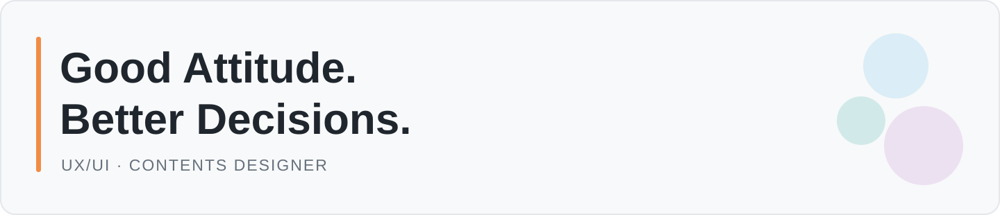
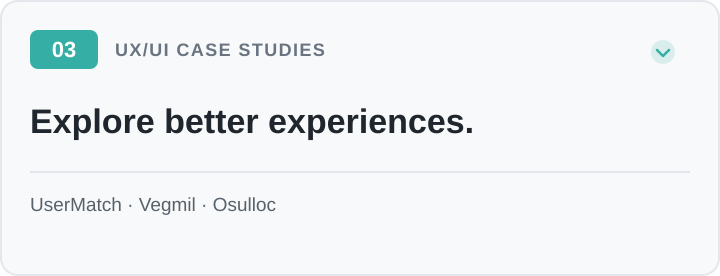

다양한 관점을 이해하고, 맥락을 연결해 더 나은 경험을 설계합니다. 제품·콘텐츠·웹 디자인을 기반으로 AI와 개발까지 배움과 실행을 확장하고 있습니다.

---

<h2>Selected Works · 12 Projects</h2>

<table width="100%">
<tr>
<td width="50%" valign="top">

 

<strong>역전 커리어 루트</strong> 면접·경험 관리를 기반으로 개인의 커리어 경로를 지속적으로 관리하고, 축적된 기록을 통해 다양한 커리어 루트를 탐색하는 DeskBuddy 웹앱 서비스

<strong>WANTMORE</strong> 따로, 또 같이 — AI 공유 스터디 기록 플랫폼

<strong>xFold</strong> AI 및 개인 스터디를 위한 공유 학습 Wiki 플랫폼

</td>
<td width="50%" valign="top">

 

<strong>동행 🏆</strong> 사후 행정 절차와 필요 서류를 안내하는 서비스 <em>goorm DEEP DIVE 합반 프로젝트 대상</em>

<strong>CareLink 🏆</strong> 국내 체류 외국인을 위한 의료 전·중·후 경험 연결 AI 서비스 <em>해커톤 최우수상</em>

<strong>BetterFit</strong> 운동·식단·수면·의료·복용 기록을 통합하는 개인 건강 관리 서비스

</td>
</tr>
<tr>
<td width="50%" valign="top">

 

<strong>UserMatch</strong> 사용자 조사 참여자를 위한 1:1 및 다수 매칭 기반 품앗이 서비스

<strong>Vegmil 반응형 웹 디자인</strong> 브랜드·제품 분류 UX/IA 개선 및 온·오프라인 경험 연결, 입점·이벤트 태그 설계

<strong>오설록 반응형 웹 디자인</strong> 공간·제품 탐색 UX/IA 개선 및 온·오프라인 경험 연결, 웹 리브랜딩과 뷰티포인트 경험 설계

</td>
<td width="50%" valign="top">

 

<strong>INCI Scope</strong> 화장품 위험 전성분 검토 및 관리 서비스

<strong>Exposition</strong> 전시 준비 과정과 팀 협업을 위한 프로젝트 관리 서비스

<strong>QFIT</strong> 인쇄 규격과 대량 작업을 지원하는 QR 코드 생성·관리 서비스

</td>
</tr>
</table>

Design · Research · AI · Development
